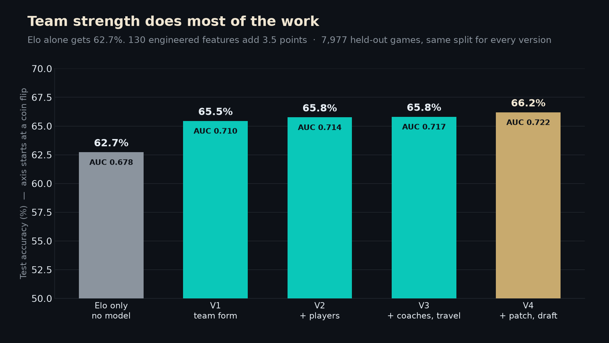
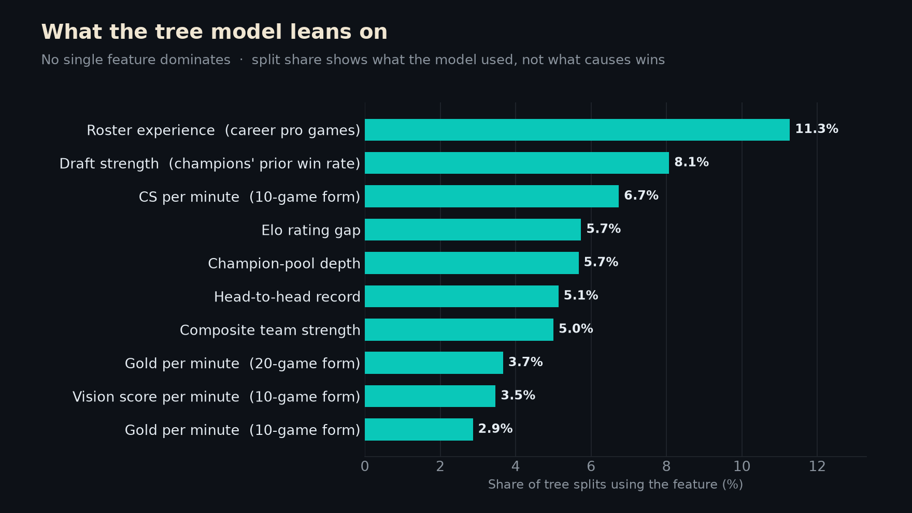

# LoL Esports Match Prediction Model

A machine-learning model that predicts the winner of professional *League of Legends*
esports matches, **built entirely from scratch in NumPy** — no scikit-learn, no XGBoost,
no deep-learning frameworks. Every algorithm (logistic regression, gradient-boosted trees,
random forest, a small MLP, and a stacking ensemble) is implemented by hand in
[`src/ml_from_scratch.py`](src/ml_from_scratch.py).

Built on **58,842 games** from [Oracle's Elixir](https://oracleselixir.com) (2021 – November 2026).
On 7,977 held-out games the best model reaches **AUC 0.722 / 66.2% accuracy**, against
**62.7%** for an Elo rating alone.

**Live demo:** https://hget15.github.io/lol-esports-predictor/ — pick any two pro teams and
see the prediction with its reasoning.

The question behind the project is a game-design one: *when two pro teams sit down, what
actually decides the result?* The answer the data gives is unglamorous. **Team strength does
most of the work, 130 engineered features add about three and a half points on top, and a
third of games still go against the best available prediction.**



> Constraint that shaped the project: the build environment had no internet package access
> (a proxy blocked `pip`), so every model had to be written from first principles in NumPy.

---

## Correction: the original V4 result was wrong

Earlier versions of this README reported **AUC 0.797 / 72.1% accuracy** for V4 and named
"patch adaptation" as the dominant predictor. **Both claims were artifacts of look-ahead in
the V4 features and have been withdrawn.**

- **What happened.** `v4_enhancements.py` filled its patch and champion trackers with every
  game in the dataset and only then computed each game's features. A team's "win rate on the
  current patch" therefore included the game being predicted and games after it, and "recent
  form" was the team's last ten games of the whole dataset.
- **How it was found.** Checking why one feature (`patch_wr_delta_diff`) carried a quarter of
  the model's importance. Recomputed correctly on one season, that feature's stand-alone AUC
  fell from 0.776 to 0.559, and the model's from about 0.82 to about 0.70.
- **The fix.** Games are now collected, sorted by date, and each game's features are read
  *before* that game is recorded (`build_pre_game_features`). V1 and V2 already worked this
  way.
- **The guard.** [`tests/test_no_lookahead.py`](tests/test_no_lookahead.py) asserts that
  changing a game's result, or any later result, leaves that game's features unchanged.
- **Every number below** comes from one script, [`src/evaluate_versions.py`](src/evaluate_versions.py),
  which puts all four feature versions through the same games and the same split.

One smaller look-ahead remains and is left as is: V3's coach tenure and regional playstyle
averages are counted over the whole dataset. Neither uses match results.

---

## Hypothesis

> Professional match outcomes can be predicted meaningfully better than a naive
> team-strength baseline (Elo) by engineering features from historical match data — and in
> particular, contextual "meta" signal (patch and champion meta) carries predictive
> information beyond raw team strength.

Two sub-questions drove the four versions:

1. Does adding **player-, coach-, and travel-level** context beat a team-only baseline?
2. Does **patch/champion meta** context add signal on top of that?

---

## What was tested

Four feature generations, each evaluated on the **same** games and time-ordered split.

| Version | Feature theme added | # features |
|--------:|---------------------|:----------:|
| **V1** | Elo, rolling win rates and in-game stats, side, head-to-head, league tier, Bo-format | 59 |
| **V2** | Per-player tracking: KDA, champion pools, hot streaks, series momentum, fearless-draft & sub detection | 79 |
| **V3** | Coaches (Leaguepedia), travel / home advantage, regional playstyle profiles | 106 |
| **V4** | Patch meta (patch maturity, patch-vs-recent win-rate delta) + champion meta (pick rate, champion win rate, comfort, meta conformity, ban pressure) | 130 |

Models compared on every version: **Logistic Regression** and **Gradient-Boosted Trees**.
The library also implements a Random Forest, a 2-hidden-layer Neural Network and a Stacking
Ensemble (used in the per-version training scripts).

### Methodology

- **Temporal split**, ordered by date: the first 75% of games train the model (39,881 games,
  through May 2025), the last 15% test it (7,977 games, February – November 2026). The 10%
  in between is a validation slice the headline run does not use.
- Only games where both teams have at least five prior games are used (53,175 of 58,842).
- Every feature for a game is computed from games that finished before it.
- Standardisation is fitted on the training games only.
- An **Elo-only baseline** (the pre-game Elo expectation, no model) is reported alongside.

---

## Results

Test set: 7,977 games. From `results/model_comparison.csv`.

| Features | Model | AUC | Brier | Log loss | Accuracy |
|----------|-------|:---:|:-----:|:--------:|:--------:|
| Elo only | none | 0.678 | 0.228 | 0.647 | 62.7% |
| V1 (59) | Logistic Regression | 0.710 | 0.218 | 0.628 | 65.5% |
| V1 (59) | GBDT | 0.708 | 0.217 | 0.624 | 65.3% |
| V2 (79) | Logistic Regression | 0.714 | 0.216 | 0.623 | 65.8% |
| V2 (79) | GBDT | 0.714 | 0.215 | 0.619 | 64.9% |
| V3 (106) | Logistic Regression | 0.717 | 0.215 | 0.619 | 65.8% |
| V3 (106) | GBDT | 0.714 | 0.215 | 0.619 | 65.0% |
| **V4 (130)** | **Logistic Regression** | **0.722** | **0.213** | **0.615** | **66.2%** |
| V4 (130) | GBDT | 0.717 | 0.214 | 0.617 | 65.5% |

How to read it:

- **Rolling team form on top of Elo is the one clear step**: 62.7% → 65.5%.
- **Each later version adds a fraction of a point.** One standard error on accuracy here is
  about half a point, so no single step from V1 to V4 is distinguishable from noise on its
  own. Logistic-regression AUC does rise at every step (0.710 → 0.714 → 0.717 → 0.722).
- **The plain linear model matches or beats the trees** on every version.

How much each idea carries by itself (stand-alone AUC on the test set; 0.5 means nothing):

| Feature | AUC alone |
|---------|:---------:|
| Elo rating gap | 0.678 |
| Win-rate gap, last 10 games | 0.656 |
| Coach's win rate with the team | 0.637 |
| Roster experience (career pro games) | 0.631 |
| Patch win rate vs. recent form | 0.566 |
| Prior win rate of the champions drafted | 0.558 |
| Travel / home advantage | 0.500 |



### Worlds 2026 back-test

Trained on every game before the event (52,147 games through 16 September 2026), tested on
the 110 games Oracle's Elixir labels as Worlds 2026 (`results/model_comparison_WLDs_2026.csv`,
per-game predictions in `results/predictions_WLDs_2026.csv`).

| | Games picked correctly | AUC |
|---|:---:|:---:|
| Elo only | 50.0% | 0.562 |
| V4 Logistic Regression | 56.4% | 0.626 |
| V4 GBDT | 50.9% | 0.563 |

The logistic regression's pre-series pick won 29 of 49 series. It favoured Gen.G in every
series they played and gave them 71% in the final, which Bilibili Gaming won 3–1. It had
also picked against Bilibili Gaming in their two series before the final.

---

## Conclusion

- **The first sub-question gets a qualified yes.** Team form, player, coach and draft context
  lift accuracy from 62.7% (Elo) to 66.2%, and calibration improves with it (Brier 0.228 →
  0.213). Almost all of that comes from the first step, rolling team form.
- **The second gets a no, as far as this data can tell.** Patch and champion-meta features
  moved accuracy from 65.8% to 66.2%, inside the noise. The earlier "patch adaptation decides
  matches" result was a bug, not a finding.
- **The ceiling is low.** With 130 features the best model is wrong about one game in three,
  and at Worlds it is barely ahead of a coin flip.
- **Simple beat complex.** Logistic regression was at least as good as gradient-boosted trees
  everywhere it was compared.

---

## What this says about League — a designer's lens

I built this to interrogate the game's systems with data rather than to chase an accuracy
number. What the corrected results support:

- **Pre-game, strength is nearly all there is to know.** A single Elo number gets 62.7%.
  Everything else I could engineer — player form, coaches, travel, patch, draft — adds three
  and a half points. Most of what decides a pro game is not visible in the teams' histories.
- **A third of results defy the best prediction.** For a competitive game that is arguably
  the outcome you want: the better team usually wins, but not reliably enough to make the
  match a formality.
- **Parity at the very top is real.** Among Worlds teams the model's edge almost vanishes,
  and its favourite lost the final.
- **Patch adaptation did not show up as a separate skill.** How a team is doing on the
  current patch relative to its recent form is weakly predictive on its own (AUC 0.566) and
  adds nothing measurable once ordinary form is known. If fast adapters exist, their edge is
  already in their win rate.
- **The draft carries a small signal.** The historical win rate of the champions a team
  picks is weakly predictive by itself and is the second most-used feature in the tree model.
- **Travel showed no effect at all** in how these features encode it (AUC 0.500).

Feature importance here means how often the tree model split on a feature. It shows what
the model used, not what causes wins.

---

## Repository structure

```
lol-esports-predictor/
├── README.md                     # you are here
├── worklog.md                    # original development log (with a correction note)
├── .env.example                  # env-var template (Riot API key placeholder)
├── src/                          # all model + feature-engineering code (pure NumPy)
│   ├── ml_from_scratch.py        #   ML library: LR, GBDT, RF, NN, stacking, metrics
│   ├── feature_engineering.py    #   V1 features (baseline)
│   ├── feature_engineering_v2.py #   V2 features
│   ├── build_coaches.py          #   rebuilds data/coaches.tsv from Leaguepedia
│   ├── v3_enhancements.py        #   V3 features (coaches, travel, playstyle)
│   ├── v4_enhancements.py        #   V4 features (patch meta, champion meta)
│   ├── evaluate_versions.py      #   all headline numbers: V1–V4, one split, Elo baseline
│   ├── train_and_evaluate*.py    #   per-version training with charts (V1–V3)
│   └── simulate_fst2026.py       #   First Stand 2026 tournament back-test (V3 features)
├── tests/
│   └── test_no_lookahead.py      # leakage tests for the V4 feature builder
├── app/                          # live demo web app (Vite + React + Tailwind) → GitHub Pages
│   ├── src/model.js              #   calibrated Elo + form proxy, H2H rule, URL state (pure functions)
│   ├── src/App.jsx               #   render-only components
│   ├── src/data/teams.json       #   50 teams, rosters as of Mar 2026
│   └── legacy/                   #   the original single-file components (their header text predates the correction)
├── models/                       # V4 logistic-regression weights + scaler (NumPy .npz)
├── results/
│   ├── model_comparison.csv            # the results table above
│   ├── feature_importance.csv          # top V4 GBDT features
│   ├── model_comparison_WLDs_2026.csv  # Worlds 2026 back-test
│   ├── predictions_WLDs_2026.csv       # per-game Worlds predictions
│   └── charts/                         # README charts; v2/ and v3/ hold plots from the original runs
└── data/                         # (gitignored) raw Oracle's Elixir CSVs — see data/README.md
```

---

## Running it

Requires Python 3.9+ with `numpy` and `pandas` (`matplotlib` and `seaborn` only for the
per-version training scripts). Run everything from the repository root.

1. **Get the data** — follow [`data/README.md`](data/README.md) to download the Oracle's
   Elixir CSVs into `data/`.
2. **Build features and evaluate:**
   ```bash
   python src/feature_engineering.py       # V1 features
   python src/feature_engineering_v2.py    # V2
   python src/build_coaches.py             # coach file from Leaguepedia (slow: the API is rate-limited)
   python src/v3_enhancements.py           # V3
   python src/v4_enhancements.py           # V4
   python src/evaluate_versions.py         # the results table (about 20 minutes; the trees are pure Python)
   python src/evaluate_versions.py --holdout WLDs 2026 --versions V3 V4
   ```
3. **Tests:**
   ```bash
   python -m unittest tests.test_no_lookahead -v
   ```
4. **Prediction UI** — the live demo is a small Vite app in `app/`:
   ```bash
   cd app && npm install && npm run dev
   ```
   `npm test` pins the demo's numbers (Gen.G vs T1 → 0.629). The demo uses a calibrated
   Elo + win-rate formula rather than the full model, which needs a 130-feature vector per
   game, plus per-role player head-to-head stats.

### Riot API key

No script currently calls the Riot API. A development key was reserved for planned
solo-queue data enrichment; if you wire it up, copy `.env.example` to `.env` and set
`RIOT_API_KEY`. `.env` is gitignored.

---

## Notes & credits

- Match data © [Oracle's Elixir](https://oracleselixir.com) (Tim Sevenhuysen). Please credit
  the source and follow their terms.
- Coach data from [Leaguepedia](https://lol.fandom.com) (CC BY-SA 3.0), rebuilt by
  `src/build_coaches.py`. It covers 86% of team-games; the coach file used for the original
  runs was not kept, so V3 numbers here are not a reproduction of those runs.
- All ML implemented from scratch in NumPy as a deliberate exercise — see
  [`worklog.md`](worklog.md) for the engineering narrative behind each version.
